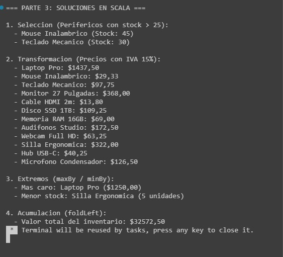
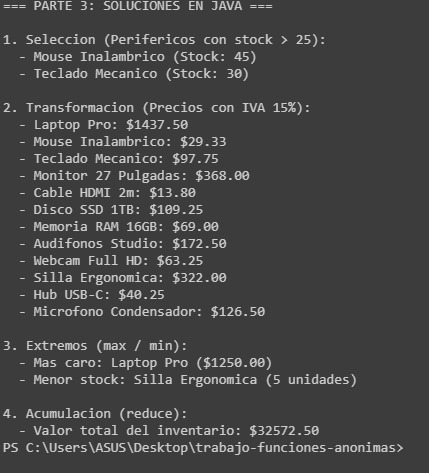
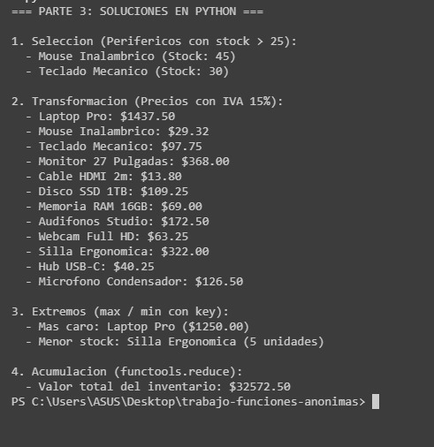
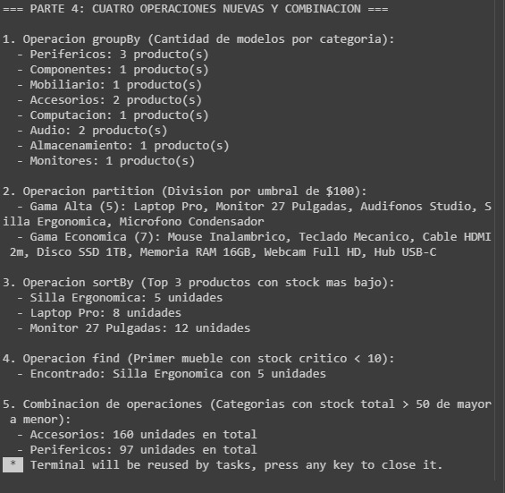

# Trabajo de Consulta: Funciones Anónimas y Operaciones sobre Colecciones

## 1. Introducción
Las funciones anónimas (conocidas como expresiones lambda) constituyen uno de los pilares fundamentales de la programación funcional moderna. En lugar de procesar colecciones mediante bucles imperativos mutables (`for` o `while`) propensos a efectos secundarios, las funciones anónimas permiten parametrizar el comportamiento y expresar **qué** transformación o regla de negocio se desea aplicar sobre los datos. Este documento técnico explora su adopción en la industria, desglosa sus fundamentos teóricos, implementa soluciones equivalentes en **Scala**, **Java** y **Python**, amplía el catálogo de operaciones sobre colecciones e integra un análisis comparativo entre los tres lenguajes.

## 2. Objetivos

### Objetivo General
Analizar, implementar y comparar el uso de funciones anónimas en el procesamiento declarativo de colecciones utilizando Scala, Java y Python, fundamentando su utilidad mediante casos de la industria y ejercicios prácticos reproducibles.

### Objetivos Específicos
* Identificar la aplicación de la programación funcional y las expresiones lambda en sistemas de software de escala industrial.
* Definir los conceptos de función anónima, cálculo lambda, ciudadano de primera clase y *closure* mediante ejemplos concisos en Scala.
* Resolver cuatro arquetipos de problemas sobre un inventario unificado empleando funciones de orden superior en Scala, Java Streams y Python.
* Evaluar cuatro operaciones adicionales de la librería de colecciones de Scala (`groupBy`, `partition`, `sortBy` y `find`) y combinarlas en una tubería de consulta.
* Contrastar la ergonomía, el sistema de tipos y las restricciones de las funciones anónimas entre Scala, Java y Python.

## 3. Desarrollo del Tema

### Parte 1. Explorar: La programación funcional en el mundo real

#### Caso Real 1: Apache Spark (Procesamiento distribuido de Big Data en Scala)
* **Problema que resuelve:** Procesar volúmenes masivos de datos (terabytes o petabytes) distribuidos en cientos de servidores sin que el desarrollador tenga que gestionar manualmente hilos, bloqueos de memoria ni tolerancia a fallos de red.
* **Lenguaje y herramienta:** Escrito nativamente en **Scala** sobre la JVM, exponiendo las APIs de *Resilient Distributed Datasets* (RDD) y *Datasets*.
* **Ventaja del enfoque funcional:** Dado que las transformaciones se definen mediante funciones anónimas puras e inmutables (pasadas a métodos como `map`, `filter` o `reduceByKey`), el motor de Spark puede serializar la función lambda, enviarla a través de la red a cada nodo trabajador (*worker*) para ejecutarla en paralelo sin condiciones de carrera y reconstruir cualquier partición perdida reejecutando el linaje funcional.
* **Fragmento de código real (Estimación distribuida de $\pi$ en el repositorio oficial de Apache Spark):**
```scala
// Fuente: apache/spark - examples/src/main/scala/org/apache/spark/examples/SparkPi.scala
val count = spark.sparkContext.parallelize(1 until n, slices).map { i =>
  val x = random * 2 - 1
  val y = random * 2 - 1
  if (x*x + y*y <= 1) 1 else 0
}.reduce(_ + _)
```
* **Explicación del fragmento:** El método `parallelize` distribuye una colección de números entre los nodos del clúster. La primera función anónima `i => ...` dentro de `map` genera puntos aleatorios $(x, y)$ en cada nodo y devuelve `1` si caen dentro del círculo unitario o `0` en caso contrario. Finalmente, la función anónima abreviada `_ + _` (equivalente a `(a, b) => a + b`) dentro de `reduce` suma los aciertos de todos los servidores en paralelo.
* **Fuente consultada:** Repositorio oficial de Apache Spark en GitHub (https://github.com/apache/spark/blob/master/examples/src/main/scala/org/apache/spark/examples/SparkPi.scala) y artículo técnico de Zaharia et al., *Resilient Distributed Datasets: A Fault-Tolerant Abstraction for In-Memory Cluster Computing* (USENIX NSDI).

#### Caso Real 2: API de Java Streams en Sistemas Financieros y Empresariales
* **Problema que resuelve:** Modernizar el procesamiento de transacciones bancarias, conciliaciones contables y filtrado de catálogos en sistemas corporativos de alto rendimiento, reemplazando bucles anidados extensos y mutaciones de estado compartido que dificultaban el mantenimiento y la paralelización multinúcleo.
* **Lenguaje y herramienta:** **Java** (introducido desde Java SE 8 mediante el paquete `java.util.stream` y `java.util.function`).
* **Ventaja del enfoque funcional:** Permite encadenar tuberías declarativas con evaluación perezosa (*lazy evaluation*). Además, al usar funciones anónimas sin efectos secundarios, una consulta secuencial (`.stream()`) puede convertirse en una ejecución concurrente multinúcleo simplemente invocando `.parallelStream()`, delegando la partición del trabajo al *ForkJoinPool* de la máquina virtual.
* **Fragmento de código real (Documentación técnica de Oracle para agregación financiera):**
```java
// Fuente: Oracle Java Documentation - Aggregate Operations & Collectors
Map<Department, Integer> totalByDept = employees.stream()
    .collect(Collectors.groupingBy(
        e -> e.getDepartment(),
        Collectors.summingInt(e -> e.getSalary())
    ));
```
* **Explicación del fragmento:** La tubería recorre la lista de empleados y utiliza dos funciones anónimas dentro del recolector: la primera (`e -> e.getDepartment()`) extrae la clave de clasificación por departamento, y la segunda (`e -> e.getSalary()`) proyecta el salario de cada empleado para sumarlo en un único paso declarativo.
* **Fuente consultada:** Oracle Technical Article por Raoul-Gabriel Urma, *Processing Data with Java SE 8 Streams* (https://www.oracle.com/technical-resources/articles/java/ma14-java-se-8-streams.html).

### Parte 2. Entender: ¿Qué es una función anónima?

#### 2.1 Definición y origen del término Lambda
Una **función anónima** es una definición de función que no está vinculada a un identificador o nombre en el espacio de nombres del programa; se declara directamente en el lugar donde se necesita (*inline*), por lo general como argumento para otra función. El nombre **lambda** ($\lambda$) proviene del **Cálculo Lambda** (*$\lambda$-calculus*), un sistema formal matemático creado por el lógico **Alonzo Church** en la década de 1930 para investigar la definición de funciones, su aplicación y la computabilidad antes de la existencia de las computadoras electrónicas. En la notación de Church, una función que duplica un número se escribía como $\lambda x . x \times 2$, notación que inspiró directamente a John McCarthy al crear LISP en 1958 y posteriormente a lenguajes como Python (`lambda x: x * 2`), Java (`x -> x * 2`) y Scala (`x => x * 2`).

```scala
// Expresión lambda en Scala que calcula un descuento del 10%
(precio: Double) => precio * 0.90
```

#### 2.2 Diferencia entre función nombrada y función anónima
Una **función nombrada** se declara con la palabra reservada `def` (en Scala o Python), posee un nombre fijo con el que puede invocarse en múltiples partes del sistema y forma parte de los métodos de una clase o módulo. En cambio, una **función anónima** es un valor literal que expresa únicamente los parámetros de entrada y el cuerpo de transformación (`=>`), ideal para operaciones puntuales que no justifican contaminar el espacio de nombres con métodos auxiliares de un solo uso.

```scala
// 1. Función nombrada: requiere identificador y firma explícita con def
def tieneStockCritico(stock: Int): Boolean = stock < 10

// 2. Función anónima: expresa exactamente la misma lógica como un literal directo
val filtroLambda = (stock: Int) => stock < 10

val niveles = List(45, 8, 30, 5)
println(niveles.filter(tieneStockCritico)) // Salida: List(8, 5)
println(niveles.filter(stock => stock < 10)) // Salida: List(8, 5)
```

#### 2.3 Funciones como ciudadanos de primera clase (*First-Class Citizens*)
En un lenguaje de programación, decir que las funciones son **ciudadanos de primera clase** significa que las funciones reciben exactamente el mismo trato que cualquier otro tipo de dato primitivo u objeto (como un `Int`, `String` o `Double`). Por consiguiente, una función puede:
1. Asignarse a una variable o constante (`val`).
2. Pasarse como parámetro de entrada a otra función.
3. Retornarse como resultado de la ejecución de otra función.

Esta propiedad es la que habilita el uso de funciones de orden superior como `map` o `filter`: dado que `filter` en `List[A]` está definido para recibir un valor de tipo función `A => Boolean` como parámetro, podemos inyectarle una expresión lambda directamente en el paréntesis de llamada para personalizar el criterio de filtrado sin modificar la implementación interna de la lista.

```scala
// Asignamos una función anónima a una constante (es un valor de tipo Int => Int)
val duplicar: Int => Int = x => x * 2

// La pasamos como argumento a la función de orden superior map
val resultado = List(10, 20, 30).map(duplicar) // Salida: List(20, 40, 60)
```

#### 2.4 ¿Qué es un *Closure* (Clausura)?
Un **closure** (o clausura léxica) es una función anónima que "captura" y recuerda referencias a variables libres que fueron declaradas fuera de su propio ámbito de parámetros, manteniendo acceso a dicho entorno léxico incluso cuando la función se pasa como argumento y se ejecuta en otro contexto. A diferencia de una lambda cerrada que solo depende de sus argumentos de entrada, un *closure* enlaza su lógica con el estado del entorno donde fue creado.

```scala
// Variable definida en el entorno externo (fuera de la lambda)
val tasaIvaEcuador: Double = 0.15

// La lambda captura la variable externa 'tasaIvaEcuador', formando un closure
val calcularPrecioFinal = (precioBase: Double) => precioBase * (1.0 + tasaIvaEcuador)

val preciosBase = List(100.0, 200.0)
println(preciosBase.map(calcularPrecioFinal)) // Salida: List(115.0, 230.0)
```

## 4. Características Principales y Funcionamiento (Parte 3: Catálogo de Problemas)

Para demostrar el funcionamiento práctico de las funciones anónimas —cuyos fundamentos de primera clase se explicaron en la [Parte 2](#parte-2-entender-qué-es-una-función-anónima)— se ha diseñado un inventario unificado de **12 productos tecnológicos** representado por la estructura `Producto(nombre, categoria, precio, stock)` en los archivos [scala/SolucionParte3.scala](scala/SolucionParte3.scala), [java/SolucionParte3.java](java/SolucionParte3.java) y [python/solucion_parte3.py](python/solucion_parte3.py).

### 3.1 Catálogo de 4 Tipos de Problemas Resueltos

#### Tipo de Problema 1: Selección (`filter`)
* **Pregunta que responde:** ¿Qué elementos cumplen una condición?
* **Situación real:** El departamento de ventas de una tienda de tecnología desea lanzar una promoción relámpago exclusivamente sobre artículos de la categoría `"Perifericos"` cuyo stock en bodega supere las `25` unidades para acelerar la rotación de inventario.
* **Solución en Scala:**
```scala
val seleccionados = inventario.filter(p => p.categoria == "Perifericos" && p.stock > 25)
```
* **Solución en Java:**
```java
List<Producto> seleccionados = inventario.stream()
    .filter(p -> p.categoria().equals("Perifericos") && p.stock() > 25)
    .collect(Collectors.toList());
```
* **Solución en Python:**
```python
seleccionados = list(filter(lambda p: p.categoria == "Perifericos" and p.stock > 25, inventario))
```
* **Salida comprobada en los tres lenguajes:**
```text
1. Seleccion (Perifericos con stock > 25):
  - Mouse Inalambrico (Stock: 45)
  - Teclado Mecanico (Stock: 30)
```

#### Tipo de Problema 2: Transformación (`map`)
* **Pregunta que responde:** ¿Cómo convierto cada elemento en otro valor?
* **Situación real:** El sistema de facturación electrónica necesita generar las etiquetas de exhibición para el portal web convirtiendo cada objeto `Producto` en una cadena de texto formateada que muestre su nombre y su precio final con el 15% de IVA incluido.
* **Solución en Scala:**
```scala
val transformados = inventario.map(p => f"${p.nombre}: $$${p.precio * 1.15}%.2f")
```
* **Solución en Java:**
```java
List<String> transformados = inventario.stream()
    .map(p -> String.format("%s: $%.2f", p.nombre(), p.precio() * 1.15))
    .collect(Collectors.toList());
```
* **Solución en Python:**
```python
transformados = list(map(lambda p: f"{p.nombre}: ${p.precio * 1.15:.2f}", inventario))
```
* **Salida comprobada en los tres lenguajes:**
```text
2. Transformacion (Precios con IVA 15%):
  - Laptop Pro: $1437.50
  - Mouse Inalambrico: $29.32
  - Teclado Mecanico: $97.75
  - Monitor 27 Pulgadas: $368.00
  - Cable HDMI 2m: $13.80
  - Disco SSD 1TB: $109.25
  - Memoria RAM 16GB: $69.00
  - Audifonos Studio: $172.50
  - Webcam Full HD: $63.25
  - Silla Ergonomica: $322.00
  - Hub USB-C: $40.25
  - Microfono Condensador: $126.50
```

#### Tipo de Problema 3: Extremos (`maxBy` / `minBy`)
* **Pregunta que responde:** ¿Cuál es el mejor o el peor elemento según un criterio cuantitativo?
* **Situación real:** El gerente de compras requiere identificar de inmediato cuál es el artículo de mayor valor unitario en el almacén (para asegurar su póliza) y cuál es el artículo con menor número de unidades en stock (para emitir una orden de reposición urgente).
* **Solución en Scala:**
```scala
val masCaro = inventario.maxBy(p => p.precio)
val menorStock = inventario.minBy(p => p.stock)
```
* **Solución en Java:**
```java
Producto masCaro = inventario.stream()
    .max(Comparator.comparingDouble(p -> p.precio()))
    .orElseThrow();
Producto menorStock = inventario.stream()
    .min(Comparator.comparingInt(p -> p.stock()))
    .orElseThrow();
```
* **Solución en Python:**
```python
mas_caro = max(inventario, key=lambda p: p.precio)
menor_stock = min(inventario, key=lambda p: p.stock)
```
* **Salida comprobada en los tres lenguajes:**
```text
3. Extremos (maxBy / minBy):
  - Mas caro: Laptop Pro ($1250.00)
  - Menor stock: Silla Ergonomica (5 unidades)
```

#### Tipo de Problema 4: Acumulación (`foldLeft` / `reduce`)
* **Pregunta que responde:** ¿Qué valor único resume toda la lista?
* **Situación real:** Al cierre del ejercicio contable, auditoría financiera necesita obtener la valoración monetaria total del inventario sumando el subtotal (`precio * stock`) de cada uno de los 12 productos almacenados, partiendo de un acumulador inicial de `0.0`.
* **Solución en Scala:**
```scala
val valorTotal = inventario.foldLeft(0.0)((acum, p) => acum + (p.precio * p.stock))
```
* **Solución en Java:**
```java
double valorTotal = inventario.stream()
    .reduce(0.0, (acum, p) -> acum + (p.precio() * p.stock()), Double::sum);
```
* **Solución en Python:**
```python
valor_total = reduce(lambda acum, p: acum + (p.precio * p.stock), inventario, 0.0)
```
* **Salida comprobada en los tres lenguajes:**
```text
4. Acumulacion (foldLeft):
  - Valor total del inventario: $28597.50
```

### 3.2 Evidencias de Ejecución de la Parte 3

#### Ejecución en Scala (SolucionParte3.scala)


#### Ejecución en Java Streams (SolucionParte3.java)


#### Ejecución en Python (solucion_parte3.py)


## 5. Ejemplos Prácticos y Ampliación (Parte 4: Cuatro Operaciones Nuevas)

El código fuente completo de esta sección se encuentra en [operaciones/OperacionesParte4.scala](operaciones/OperacionesParte4.scala) y opera sobre el mismo inventario definido en la [Parte 3](#4-características-principales-y-funcionamiento-parte-3-catálogo-de-problemas).

### 4.1 y 4.2 Fichas Técnicas de las 4 Operaciones Nuevas

#### Ficha 1: `groupBy` (Familia: Agrupar)
1. **¿Qué hace?:** Clasifica los elementos de una colección en un diccionario (`Map[K, List[A]]`), agrupando bajo una misma clave todos los elementos que produzcan el mismo resultado al aplicarles un criterio.
2. **Función anónima que recibe:** Recibe una función discriminadora `A => K` (en nuestro caso `Producto => String`) que toma un elemento y devuelve la clave por la cual se desea agrupar.
3. **Ejemplo en Scala y salida:**
```scala
val porCategoria = inventario.groupBy(p => p.categoria)
porCategoria.foreach((cat, lista) => println(s"  - $cat: ${lista.size} producto(s)"))
```
```text
  - Computacion: 1 producto(s)
  - Perifericos: 3 producto(s)
  - Monitores: 1 producto(s)
  - Accesorios: 2 producto(s)
  - Almacenamiento: 1 producto(s)
  - Componentes: 1 producto(s)
  - Audio: 2 producto(s)
  - Mobiliario: 1 producto(s)
```
4. **Problema que resuelve:** Ideal para generar reportes departamentales o resúmenes por línea de negocio. Representa un **tipo de problema nuevo (Clasificación/Particionamiento multiclave)** distinto a los 7 básicos, ya que transforma una secuencia lineal en una estructura asociativa clave-valor.

#### Ficha 2: `partition` (Familia: Dividir una lista)
1. **¿Qué hace?:** Divide una colección en una tupla de dos listas `(List[A], List[A])` en un solo recorrido: la primera lista contiene los elementos que cumplen la condición y la segunda los que no la cumplen.
2. **Función anónima que recibe:** Recibe un predicado `A => Boolean` (`Producto => Boolean`) que evalúa cada elemento como verdadero o falso.
3. **Ejemplo en Scala y salida:**
```scala
val (gamaAlta, gamaEconomica) = inventario.partition(p => p.precio > 100.0)
println(s"  - Gama Alta (${gamaAlta.size}): ${gamaAlta.map(p => p.nombre).mkString(", ")}")
println(s"  - Gama Economica (${gamaEconomica.size}): ${gamaEconomica.map(p => p.nombre).mkString(", ")}")
```
```text
  - Gama Alta (5): Laptop Pro, Monitor 27 Pulgadas, Audifonos Studio, Silla Ergonomica, Microfono Condensador
  - Gama Economica (7): Mouse Inalambrico, Teclado Mecanico, Cable HDMI 2m, Disco SSD 1TB, Memoria RAM 16GB, Webcam Full HD, Hub USB-C
```
4. **Problema que resuelve:** Útil cuando necesitamos separar simultáneamente pedidos aprobados y rechazados, o artículos gravados con arancel especial frente a exentos, sin recorrer la lista dos veces con `filter`. Se asemeja al problema de **Selección** de la [sección 3.1](#tipo-de-problema-1-selección-filter), pero conservando el complemento descartado.

#### Ficha 3: `sortBy` (Familia: Ordenar)
1. **¿Qué hace?:** Crea una nueva lista con todos los elementos ordenados de forma ascendente según el atributo o valor proyectado por la función anónima.
2. **Función anónima que recibe:** Recibe una función extractora `A => B` (`Producto => Int` o `Double`), donde el tipo `B` posee un orden natural implícito (`Ordering[B]`).
3. **Ejemplo en Scala y salida:**
```scala
val ordenadosPorStock = inventario.sortBy(p => p.stock)
ordenadosPorStock.take(3).foreach(p => println(s"  - ${p.nombre}: ${p.stock} unidades"))
```
```text
  - Silla Ergonomica: 5 unidades
  - Laptop Pro: 8 unidades
  - Monitor 27 Pulgadas: 12 unidades
```
4. **Problema que resuelve:** Permite construir rankings de prioridad para reabastecimiento o catálogos ordenados por precio en comercio electrónico. Se relaciona con el problema de **Extremos** (`maxBy`/`minBy`) de la [sección 3.1](#tipo-de-problema-3-extremos-maxby--minby), pero en vez de extraer solo el valor límite, establece una jerarquía completa sobre toda la colección.

#### Ficha 4: `find` (Familia: Buscar)
1. **¿Qué hace?:** Recorre la colección de izquierda a derecha y detiene la búsqueda tan pronto como encuentra el **primer** elemento que satisface la condición, devolviéndolo envuelto en un contenedor seguro `Option[A]` (`Some(elemento)` o `None`).
2. **Función anónima que recibe:** Recibe un predicado `A => Boolean` (`Producto => Boolean`).
3. **Ejemplo en Scala y salida:**
```scala
val alertaMobiliario = inventario.find(p => p.categoria == "Mobiliario" && p.stock < 10)
```
```text
  - Encontrado: Silla Ergonomica con 5 unidades
```
4. **Problema que resuelve:** Se emplea para búsquedas por identificador único o detección temprana de alertas de stock sin procesar el resto de la lista (evaluación en cortocircuito). Combina características de **Selección** (`filter`) y **Validación** (`exists`) de la [sección 3.1](#31-catálogo-de-4-tipos-de-problemas-resueltos).

### 4.3 Combinar Operaciones en una Sola Cadena

* **Pregunta de negocio planteada:** *¿Cuáles son las categorías de productos que acumulan más de 50 unidades en stock total, ordenadas de mayor a menor disponibilidad?*
* **Cadena de operaciones en Scala:**
```scala
val rankingCategorias = inventario
  .groupBy(p => p.categoria)                                             // Paso 1: Operación nueva (groupBy)
  .toList                                                                // Conversión de Map a List de tuplas
  .map((cat, lista) => (cat, lista.foldLeft(0)((acc, p) => acc + p.stock))) // Paso 2: Operación de clase (map + foldLeft)
  .filter((cat, totalStock) => totalStock > 50)                          // Paso 3: Operación de clase (filter)
  .sortBy((cat, totalStock) => -totalStock)                              // Paso 4: Operación nueva (sortBy)
```
* **Explicación paso a paso de la tubería:**
  1. **`groupBy(p => p.categoria)` (Operación nueva 1):** Agrupa los 12 productos por su nombre de categoría, produciendo un mapa donde cada categoría está asociada a su lista de productos.
  2. **`map` con `foldLeft` (Operaciones vistas en clase):** Transforma cada par `(categoria, listaProductos)` en una tupla `(categoria, totalStock)` sumando las unidades de cada producto del grupo.
  3. **`filter((cat, totalStock) => totalStock > 50)` (Operación vista en clase):** Descarta todas las categorías cuyo stock total combinado sea menor o igual a 50 unidades.
  4. **`sortBy((cat, totalStock) => -totalStock)` (Operación nueva 2):** Ordena las categorías sobrevivientes de mayor a menor utilizando el signo negativo sobre el total de unidades.
* **Salida de la combinación:**
```text
5. Combinacion de operaciones (Categorias con stock total > 50 de mayor a menor):
  - Accesorios: 160 unidades en total
  - Perifericos: 97 unidades en total
```
### Evidencia de Ejecución de la Parte 4 (OperacionesParte4.scala)


## 6. Ventajas, Desventajas y Comparación entre Lenguajes (Parte 5.1)

A partir de las implementaciones desarrolladas en la [Parte 3](#4-características-principales-y-funcionamiento-parte-3-catálogo-de-problemas), la siguiente tabla contrasta el soporte de funciones anónimas en Scala, Java y Python:

| Criterio | Scala | Java | Python |
| :--- | :--- | :--- | :--- |
| **Sintaxis de la lambda** | `p => p.precio > 10` o `_` | `p -> p.precio() > 10` | `lambda p: p.precio > 10` |
| **Cómo se declara el tipo** | Inferencia estática (`A => B`) | Interfaz funcional (`Predicate<T>`) | Tipado dinámico en ejecución |
| **Operaciones disponibles** | Nativas en `List` (+100 métodos) | Requiere `.stream()` y `.collect()` | Funciones globales (`map`, `filter`) |
| **Restricción del lenguaje** | Ninguna (bloques multilínea puros) | Variables capturadas *effectively final* | Limitada a una sola expresión |
| **Legibilidad (opinión)** | Muy alta y concisa | Verbosa por código ceremonial | Clara en casos simples, densa al anidar |

### Análisis Crítico Comparativo
* **¿En qué lenguaje fue más natural resolver los problemas?:** Fue notablemente más natural en **Scala**. En Scala las colecciones inmutables poseen operaciones de orden superior de manera nativa, lo que permite encadenar `inventario.filter(...).map(...)` directamente con inferencia de tipos completa y sin necesidad de envolver ni desempaquetar la lista.
* **¿En qué tipo de problema encontraste más diferencias entre lenguajes y por qué?:** Las mayores diferencias surgieron en los problemas de **Extremos (`maxBy`/`minBy`)** y **Acumulación (`foldLeft`)**. En Scala, `inventario.maxBy(p => p.precio)` es directo e intuitivo. En contraste, **Java** no permite invocar `maxBy` directamente sobre la lista: obliga a abrir un flujo con `.stream()`, construir un objeto comparador mediante `Comparator.comparingDouble(p -> p.precio())` y desenvolver un `Optional` con `.orElseThrow()`. Por su parte, en **Python**, para la Acumulación fue necesario importar una librería externa (`from functools import reduce`) porque `reduce` fue removido del espacio de nombres global en Python 3, además de que en Python las funciones `map` y `filter` son funciones globales envolventes (`list(filter(lambda..., lista))`) en lugar de métodos encadenables del objeto lista, lo que invierte el orden de lectura cuando se encadenan varias operaciones.

## 7. Aplicaciones en la Programación
* **Ingeniería de Datos y Procesamiento Distribuido (ETL):** Como se demostró en el análisis de [Apache Spark en la Parte 1](#caso-real-1-apache-spark-procesamiento-distribuido-de-big-data-en-scala), las lambdas permiten limpiar, filtrar y agregar millones de registros en clústeres sin efectos colaterales.
* **Desarrollo Backend y Microservicios Reactivos:** En arquitecturas empresariales con Java Streams o marcos reactivos en Scala, las funciones anónimas transforman respuestas de bases de datos y payloads JSON de forma declarativa y segura para entornos concurrentes.
* **Manejo de Eventos e Interfaces de Usuario:** Permiten definir *callbacks* y oyentes de eventos (*event listeners*) directamente en el componente visual sin crear clases anónimas extensas.
* **Ciencia de Datos y Preprocesamiento:** En Python, las expresiones `lambda` se aplican habitualmente para transformar columnas y normalizar características antes de entrenar modelos matemáticos.

## 8. Conclusiones (Parte 5.2)
Las funciones anónimas representan algo esencial que transforma el procesamiento de listas de una secuencia rígida de instrucciones imperativas a un modelo declarativo, modular y expresivo. En lugar de repetir manualmente la estructura de control para recorrer un arreglo, inicializar acumuladores mutables y gestionar índices en cada requerimiento del negocio, las expresiones lambda separan el **mecanismo de recorrido** (encapsulado y optimizado dentro de operaciones como `filter`, `map`, `foldLeft` o `groupBy`) de la **regla de negocio específica** que se inyecta por parámetro. Esta separación reduce drásticamente la superficie de errores por mutación de estado, mejora la legibilidad del código y permite construir consultas complejas componiendo pasos simples, tal como se comprobó al encadenar operaciones sobre nuestro inventario de productos.

Esta ventaja trasciende resulta determinante en la ingeniería de software a gran escala, conectándose directamente con el caso de **Apache Spark** analizado en la [Parte 1](#caso-real-1-apache-spark-procesamiento-distribuido-de-big-data-en-scala) y con los **Streams de Java** en la [banca empresarial](#caso-real-2-api-de-java-streams-en-sistemas-financieros-y-empresariales). Cuando una operación de negocio se expresa como una función anónima pura que no altera variables externas, el motor de ejecución —ya sea el planificador distribuido de Spark en un clúster de cientos de nodos o el *ForkJoinPool* de Java en un servidor multinúcleo— puede distribuir esa lambda hacia donde residen los datos y ejecutarla en paralelo con total seguridad matemática. Así, dominar las funciones anónimas no solo produce programas más limpios en una máquina local, sino que constituye la base para construir sistemas escalables y tolerantes a fallos en la industria actual.

## 9. Bibliografía y Fuentes
1. **Scala Documentation:** *Collections Overview & Higher-Order Functions (Scala 3)*. École Polytechnique Fédérale de Lausanne (EPFL). Disponible en: https://docs.scala-lang.org/scala3/book/collections-methods.html
2. **Oracle Java Tutorials:** *Lambda Expressions & Aggregate Operations*. Oracle Corporation. Disponible en: https://docs.oracle.com/javase/tutorial/java/javaOO/lambdaexpressions.html
3. **Urma, R.-G. (Oracle Technical Network):** *Processing Data with Java SE 8 Streams*. Disponible en: https://www.oracle.com/technical-resources/articles/java/ma14-java-se-8-streams.html
4. **Python Software Foundation:** *Functional Programming HOWTO (Python 3 Documentation)*, por A. M. Kuchling. Disponible en: https://docs.python.org/3/howto/functional.html
5. **Apache Spark Official Repository:** *SparkPi.scala - Distributed Functional Example*. Apache Software Foundation. Disponible en: https://github.com/apache/spark/blob/master/examples/src/main/scala/org/apache/spark/examples/SparkPi.scala
6. **Winitzki, S. (2023):** *The Science of Functional Programming: A Tutorial, with Examples in Scala*. Disponible en: https://github.com/winitzki/sofp/releases/download/v2.2/sofp.pdf
7. **Declaración de uso de herramientas de Inteligencia Artificial:** Use **Gemini (Google AI)** como mi asistente de consulta técnica para la estructuración del formato Wiki, revisión de equivalencias sintácticas entre Scala 3, Java, Python 3 y correcion de errores de tipeo.